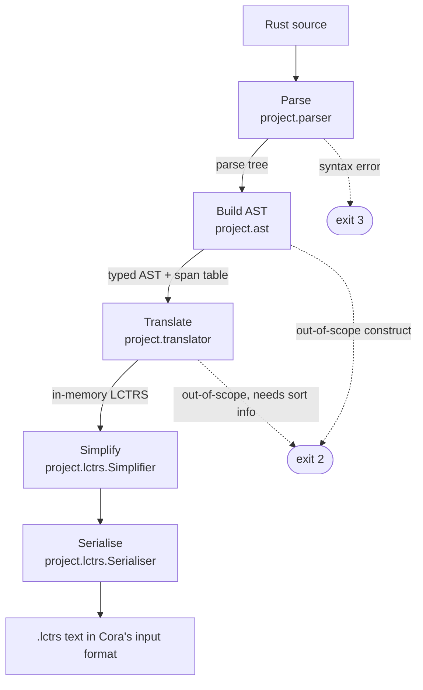

# Architecture

This document describes the structure of rust2lctrs and the reasoning behind
it. It covers the pipeline, the scheme by which Rust constructs are encoded as
rewrite rules, the simplification pass, and the principal design decisions,
together with the alternatives that were considered. Usage is covered in the
[README](../README.md).

## Pipeline



| Stage | Input → output | Failure |
|---|---|---|
| `RustParsing.parse` | source text → ANTLR parse tree | `SyntaxErrorException` (exit 3) |
| `AstBuilder` | parse tree → `Crate` (typed AST) | `Diagnostic`s for out-of-scope Rust (exit 2) |
| `Translator` | `Crate` → `Lctrs` | `UnsupportedConstructException` (exit 2) |
| `Simplifier` | `Lctrs` → smaller `Lctrs` | none; skipped with `--raw` |
| `Serialiser` | `Lctrs` → text | none |

Each stage has a single responsibility and produces a simpler or more abstract
representation than the one before it. The whole pipeline is run by
`project.Translation.of`, which both the CLI (`project.cli`) and the HTTP demo
server (`project.web.Demo`) call, so the two entry points cannot diverge in
behaviour.

The stages between parsing and serialisation are pure functions: each output
is determined entirely by its input. Only the parser and serialiser perform
IO, so impurity is confined to the edges of the pipeline. Two pieces of state
are kept outside the stages' return values. Source positions and diagnostics
are written to append-only side tables (`SpanTable`, `DiagnosticRecorder`),
and the translator shares a single `CrateScope` that allocates fresh names
across the whole crate. Crate-wide uniqueness cannot be guaranteed by a
function that translates each construct in isolation; however, since the
traversal order is fixed, the output is still deterministic across runs.

## Translation scheme

The encoding follows Fuhs, Kop and Nishida (2017), with minor modifications.
It rests on three ideas.

- **Program points.** Each position in a function's control flow is
  represented by a function symbol. The entry point takes the name of the
  source function (e.g. `sum`); interior points are numbered across the crate
  (`u1`, `u2`, …).
- **Configurations.** A configuration is a program point applied to the
  current values of the live variables, e.g. `u2(x, y)`. Each rule rewrites one
  configuration to the next, so a single rewrite step corresponds to a single
  small step of the Rust program.
- **Results.** Every program-point symbol has the codomain `result`. A
  computation leaves the system by reaching one of two kinds of sink: a
  returned value, injected into `result` by a constructor `ret_<sort>` (e.g.
  `ret_Int(v)`), or the constant `err`, which records that a panic occurred.
  Neither appears at the head of a left-hand side. A panicking computation is
  therefore terminating, which matches Rust, where a panic ends the program.

Statements are lowered to rules in one of four shapes:

| Construct | Encoding |
|---|---|
| `let`, assignment | a new program point carrying the extended or updated configuration |
| `return`, tail expression | a rewrite to `ret_<sort>` |
| `if`, `while`, `loop` | guarded rules that branch, followed by a merge point or back edge |
| function call | evaluation of the call, then a split on the callee's `ret_<sort>` or `err` |

Control flow is threaded through the translator as `Optional<Term>`. A
statement that falls through returns the configuration for the next
statement; one that diverges (`return`, `break`, `continue`, or an `if` whose
branches all diverge) returns `Optional.empty()`. A block stops lowering at the
first empty result. Statements after an early exit are therefore never
lowered, and no separate reachability pass is required.

`break` requires deferred wiring. The point at which control resumes after a
loop exists only once the loop body has been lowered, so each `break` records
its incoming configuration in a `LoopContext`, and the exit rules are emitted
when the loop closes. A consequence is that a loop with no reachable exit
receives no resumption point, and the code following it is not lowered, rather
than producing an unreachable symbol in the signature. `continue`, by
contrast, can be emitted immediately, since the loop's entry point exists
before its body is lowered.

### Integer semantics

All integer values use Cora's unbounded `Int` sort. Bit-width is expressed in
the constraints rather than in the representation, and the behaviour at the
boundary is selected by `IntegerSemantics`:

| Mode | Overflow of `+ - *` and unary `-` | Models |
|---|---|---|
| `debug` (default) | rewrites to `err`, guarded by the width bound | `cargo build` |
| `release` | wraps, as `((t − MIN) % 2^w) + MIN` | `cargo build --release` |
| `unbounded` | no bounds | no rustc configuration |

The effect is clearest on a single program under both profiles:

```rust
fn wrap_count(x: i16) -> i16 {
    let mut y: i16 = x;
    while y > 0 {
        y = y + 1;
    }
    y
}
```

`debug`:

```
wrap_count(x) -> u2(x, x) | (-32768 ≤ x) ∧ (x ≤ 32767)
u2(x, y) -> u3(x, y) | y > 0
u3(x, y) -> err | ¬((-32768 ≤ (y + 1)) ∧ ((y + 1) ≤ 32767))
u3(x, y) -> u2(x, y + 1) | (-32768 ≤ (y + 1)) ∧ ((y + 1) ≤ 32767)
u2(x, y) -> ret_Int(y) | ¬(y > 0)
```

`release`:

```
wrap_count(x) -> u2(x, x) | (-32768 ≤ x) ∧ (x ≤ 32767)
u2(x, y) -> u2(x, (((y + 1) - -32768) % 65536) + -32768) | y > 0
u2(x, y) -> ret_Int(y) | ¬(y > 0)
```

Under `debug`, each arithmetic step produces two mutually exclusive rules: a
safe path, and its negation routed to `err`. The counter must eventually reach
the bound, so Cora proves termination. Under `release`, the two guarded rules
collapse into a single unguarded one, and no `err` path is needed. The
counter wraps to a negative value and the loop exits, so the program still
terminates, but Cora can no longer use the width bound as a decreasing measure
and answers `MAYBE`.

The wrapping term is exact for any magnitude of overflow, so the same term
also covers `*`. It is sound because Cora's `%` always returns a non-negative
remainder, even when `t − MIN` is negative.

Widths are inferred from the first width-tracked variable operand of an
expression. An expression whose operands are all literals therefore carries no
bound clause. This is faithful for ordinary Rust, in which such expressions
are evaluated, and if necessary rejected, at compile time.

### Division and remainder

Division and remainder differ from the other operators in two respects.

First, they panic under both profiles: on a zero divisor, and on `MIN / -1`.
The guard is stated on the operands rather than on the result. A bound on the
result would catch `MIN / -1`, whose quotient is `MAX + 1`, but would admit
`MIN % -1`, whose remainder is `0` and in range, although it panics in Rust.

Second, Cora's `/` and `%` follow the Euclidean definition (Boute, 1992),
whereas Rust truncates toward zero. The two agree except when the dividend is
negative and the Euclidean remainder is non-zero, so the result is corrected
according to the sign of the divisor:

| Case | Corrected `/` | Corrected `%` |
|---|---|---|
| `a ≥ 0` or `a % b = 0` | `a / b` | `a % b` |
| `a < 0`, `a % b ≠ 0`, `b > 0` | `(a / b) + 1` | `(a % b) − b` |
| `a < 0`, `a % b ≠ 0`, `b < 0` | `(a / b) − 1` | `(a % b) + b` |

Under a non-zero divisor these three cases are exhaustive, so the correction
can be checked case by case rather than by sampling.

Each division is hoisted (see *Design decisions*) to its own program point,
which binds the corrected value to a fresh variable named `$div`, `$div_1`,
and so on. `$` is legal in Cora identifiers but not in Rust, so these names
cannot clash with source variables. A function with N divisions thus emits 3N
correction rules and one fault rule per division. The alternative, inlining
the corrected expression, would require 3ᴺ rules, since every combination of
cases would need its own right-hand side, and it fails for nested divisions,
where the outer fault check must refer to the corrected inner value rather
than the raw `a / b`.

## Simplification

The statement-by-statement encoding creates one symbol per program point. A
final LCTRS-to-LCTRS pass, `Simplifier`, runs between translation and
serialisation and reduces the system without changing its meaning. Its
purpose is readability rather than provability. It consists of two steps,
applied in order.

1. **Constant folding.** Constant subterms of each constraint are reduced. A
   rule whose constraint reduces to false can never fire and is removed. A
   constraint that reduces to true is dropped only if the original mentioned
   no variables; otherwise the reduced constraint replaces it only when it
   mentions exactly the same variables. Every variable in a constraint must be
   instantiated by a value for the rule to fire, so a constraint that lost a
   variable would admit rewrite steps the original did not.
2. **Program-point inlining.** A point is removed when it is defined by
   exactly one rule, that rule is unconstrained, its left-hand side applies the
   symbol to pairwise distinct variables, and its right-hand side introduces no
   further variables. Every reference to the point, at any depth, is replaced
   by its right-hand side. Candidates that lie on a cycle are excluded, since
   removing one member would leave the rest cyclic. The entry symbol of each
   function is always retained, so that a function whose body is a single step
   is not left without rules.

The order is significant: removing an unsatisfiable rule in the first step can
leave its head with a single defining rule, which the second step can then
remove.

## Design decisions

**D1. Assume valid, rustc-compilable input.** The tool reimplements none of
the compiler's static analyses: no type checking, mutability tracking,
initialisation analysis or borrow checking. A partial reimplementation would
amount to a second, weaker checker, and a maintenance liability that could
quietly disagree with rustc. This gives the scope a clear boundary and keeps
the project focused on translation.

**D2. A custom AST, built in a single walk of the parse tree.** `AstBuilder`
consumes the ANTLR parse tree once and produces immutable AST records, and
nothing downstream uses ANTLR's types. Translation rules therefore operate on
a small, closed set of node types rather than on the full grammar context,
with its lexer detail and optional-child null checks. Where a rule needs
grammar information, that information is lifted into the AST, so a change to
the grammar affects only `AstBuilder`. The cost is a second tree
representation to define and maintain, which is a reasonable price for
decoupling the grammar from the translator and for enabling snapshot testing.

**D3. An allow-list, not a deny-list.** The builders dispatch on parse-tree
context types using a pattern-matching `switch`. Only explicitly named
constructs are accepted; anything else reaches the default branch and is
rejected, so the design fails safe. ANTLR's visitor and listener generation is
disabled: a visitor-based walk would accept unhandled nodes by default, which
is a fail-open design.

**D4. Reject out-of-scope Rust as the AST is built.** Two alternatives were
rejected.

- *Translating any input and throwing on an unsupported construct.* This
  introduces a more dangerous failure mode, the possibility of plausible but
  incorrect output, and by the time translation is reached the source position
  is no longer available for a useful diagnostic.
- *Pruning the grammar to the supported fragment.* The parser cannot describe
  what it does not recognise, so a `for` loop would surface as an opaque syntax
  error instead of a diagnostic stating that `for` loops are out of scope. It
  would also fork the community grammar substantially, preventing upstream
  updates. The grammar is instead vendored whole, with its licence preserved.

One limitation is that some constructs cannot be rejected until the sort of
an operand is known. `!` is in scope as logical not on a `bool`, but on an
integer it is bitwise complement, which is not. The translator rejects such
cases, so `AstBuilder` is not the only gatekeeper. Moving this check into the
builder would require type inference, which D1 rules out.

**D5. Immutable records behind sealed interfaces.** AST nodes are records
implementing sealed interfaces, and the translator dispatches on them with an
exhaustive `switch`. Adding a construct causes a compile error at every
`switch` that does not yet handle it, so a missing case cannot go unnoticed.
Because values are immutable, no pass can alter the input of another, and
reproducibility follows from the structure rather than having to be enforced.

**D6. Spans in a side table.** Source positions are held in `SpanTable`,
keyed by node identity, rather than in a field on each node. Two identical
literals at different positions are then structurally equal, so unit tests can
compare a builder's output against an expected AST directly, while every node
remains locatable in the source.

**D7. Model Rust's overflow semantics rather than idealising them.** In
encoding C, Fuhs, Kop and Nishida idealise integers to unbounded values, which
makes the resulting systems easier to analyse. For C this is a defensible
choice, since signed overflow is undefined behaviour and any translator must
impose an interpretation. In Rust both behaviours are defined, selected by the
`overflow-checks` flag, and the choice can change whether a program
terminates. An idealised translation would model a program that no rustc
configuration produces. The tool therefore models both profiles and offers the
idealisation only as an explicit option, `--unbounded`.

Bitvector theory was also considered. It would absorb only the wrapping: the
encoding would still need to express branches, division by zero and the
division correction. Retaining the `Int` sort added little work and keeps the
output analysable by Cora.

**D8. Evaluate calls and divisions before the guards that use them.** A
constraint may contain only theory symbols and variables, so a condition such
as `if f(x) > 0` cannot be placed in a guard as written. The subexpression is
hoisted: it is moved into the right-hand side of the current rule, and a new
program point binds its result to a fresh theory-sorted variable (`$call`,
`$div`) that the guard can then refer to. One rule is emitted for each normal
form the hoisted expression can reach; for a call, that is a returned value
and `err`. The cost is one additional program point and two rules per call
site, some of which simplification removes.

The alternative, rejecting any condition that is not already a theory term,
would exclude function calls from every condition and argument. Rejection is
used only where early evaluation would change the program's meaning. Hoisting
is eager, whereas the right operand of `&&` and `||` is evaluated lazily in
Rust, so a call, division or remainder in that position is rejected.
Overflow there needs no rejection, since short-circuiting is preserved by a
disjunction in the constraint that holds when the left operand alone decides
the result.

**D9. Fix the analyser rather than narrow the fragment.** Cora's `Int` sort
was backed by Java's 32-bit `int` throughout, so it could not parse
`i32::MIN`, let alone the bounds of `u64` or `i128`. Capping the accepted
integer widths was one option. The option taken was to contribute an upstream
change backing Cora's integers with `BigInteger`
([hezzel/cora#10](https://github.com/hezzel/cora/pull/10)), which was accepted.

## Known limitations

- Semantic preservation is argued by construction and by inspection, not
  proved, and no test compares a Rust program's execution against reduction of
  the emitted system on the same inputs.
- Expressions built solely from literals carry no width bound (see *Integer
  semantics*).
- Calls, divisions and remainders are rejected in the right operand of `&&`
  and `||` (D8).
- The fragment covers integers and booleans only: floating-point arithmetic,
  references and borrowing, structs, generics, traits, closures, macros and
  `for` loops are out of scope.
